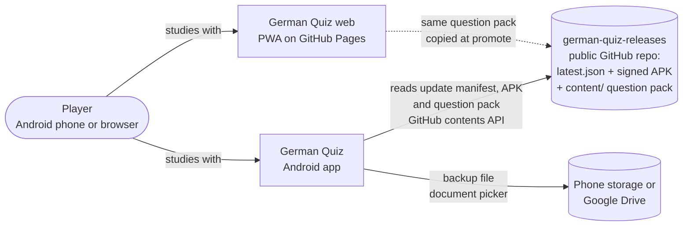
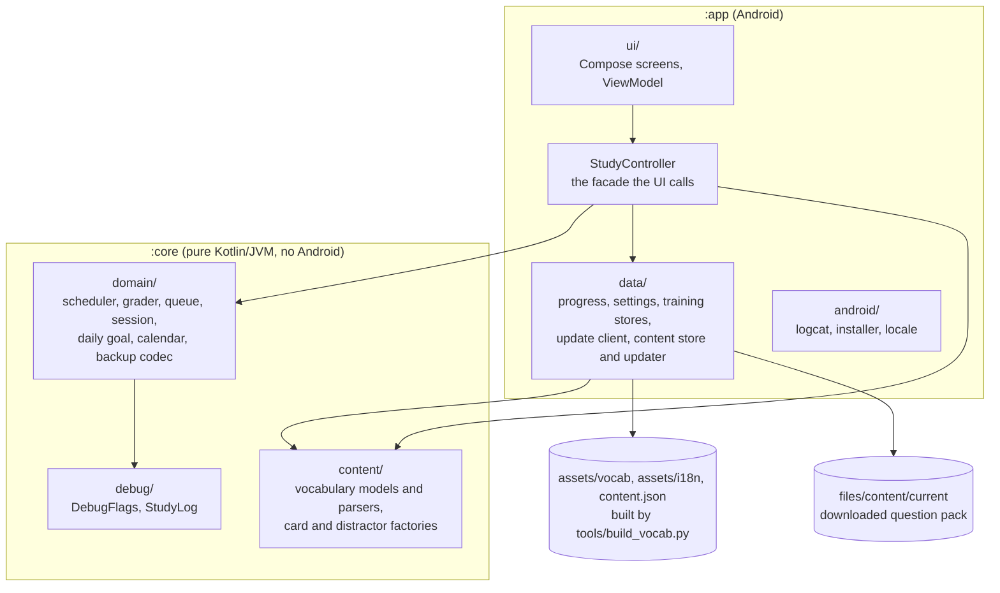

# German Quiz: design and development decisions

An offline Android app for drilling basic B2 German vocabulary with Anki-style spaced repetition.
This file explains **how the app is built** and **why** each choice was made. It is a living
document: see [How this file is maintained](#how-this-file-is-maintained).

Last updated: 2026-10-25

---

## 1. What the app is

Five study modes over a curated B2 pool (nothing beyond what every B2 speaker should know). The pool can grow without an app update: the app downloads newer question packs from its update feed (section 5, [ADR-0012](docs/adr/0012-downloadable-question-pool.md)). Pool sizes as built into version 2.7.1:

| Mode | Question | Pool |
|---|---|---|
| **Der · Die · Das** | Pick the article of a noun | 484 nouns |
| **Präpositionen** | Pick the missing preposition in a sentence (verbs, adjectives, nouns and set expressions with prepositions) | 309 items |
| **Pluralformen** | Pick the plural of a noun | the same 484 nouns |
| **Präteritum** | Pick the er/sie/es Präteritum of a verb | 253 inseparable verbs (strong and mixed first, plus modals and frequent regular verbs) |
| **Fehler finden** | Tap the one wrong part of a B2 writing sentence (forum post or formal e-mail) | 144 sentences, 12 error types |

Each question is multiple choice (in Fehler finden the "choices" are the sentence's chunks). Cards come back according to a spaced-repetition scheduler, so
wrong or slow answers return soon and well-known ones are pushed out to days, weeks and months.

Target: Android 8.0+ (`minSdk 26`), built with `compileSdk 37` / `targetSdk 36`.
Package: `dev.yuji.quiz`. Two Gradle modules (`:core` pure Kotlin, `:app` Android; see section 3), no backend, no network access except the update check and the question-pool check that runs with it (see the decision log, 2026-10-19 and 2026-10-22).

## 2. Design goals (from the original brief)

1. **Multiple quiz modes** behind one engine, so a new mode is a small addition.
2. **Anki-style repetition** of questions.
3. **Content split by game mode**, limited to basic B2 vocabulary.
4. **Encapsulated, easily debuggable code**: small pure functions chained into pipelines, descriptive
   names, and explicit debug flags.

Everything below follows from these four points.

## 3. Architecture

### System context (C4 level 1)

Who and what the app talks to. [C4](https://c4model.com) draws a system at growing zoom levels; the diagrams are
Mermaid text, so they change in the same commit as the code (GitHub renders them).



### Containers and modules (C4 level 2)



```
core/src/main/java/dev/yuji/quiz       (Gradle module :core, Kotlin/JVM plugin only)
├── domain/    cards, progress, scheduler, grader, queue pipeline, session engine, daily goal, backup codec
├── content/   vocabulary models and JSON parsers, distractor generation, card factory (vocabulary -> cards)
└── debug/     DebugFlags, StudyLog channels
app/src/main/java/dev/yuji/quiz        (Gradle module :app, depends on :core)
├── data/      persistence: progress store (JSON file), settings store, vocabulary source (assets)
├── android/   thin Android adapters (logcat logger, installer, locale)
├── ui/        Compose screens and the ViewModel
├── StudyController.kt   the single facade the UI talks to
└── MainActivity.kt
```

Dependency direction is one-way: `ui -> StudyController -> domain/content/data`. `domain`, `content` and
`debug` live in `:core`, which has no Android on its classpath: an `import android.*` there **does not compile**, so
the rule is kept by the compiler rather than by review ([ADR-0009](docs/adr/0009-pure-core-module.md)). All of
their logic is covered by plain JVM unit tests in `core/src/test` (no emulator needed). Structural decisions and
their alternatives are in [`docs/adr/`](docs/adr/README.md).

### Key pieces

- **`Card`** is the unit of study: `id`, `mode`, `prompt`, optional `context` (the sentence),
  `choices`, `correctChoice`, `explanation`. Every mode produces the same shape, which is what
  makes the engine mode-agnostic.
- **`CardProgress`** is the per-card scheduling state (phase, learning step, ease factor,
  interval, due time, lapses, suspension/removal). It is immutable; every update returns a copy.
- **`SpacedRepetitionScheduler`** is a pure function `(progress, grade, now, config) -> progress`.
  It never reads the clock itself.
- **`AnswerGrader`** turns "correct? how fast? which phase?" into an Anki grade.
- **`StudyPipeline`** builds the queue as a chain of small steps (see below).
- **`StudyEngine` / `StudySession`** hold the running session as immutable state with pure transitions.
- **`StudyController`** wires store, clock, pipeline and engine together and is the only thing the
  UI calls.
- **`Clock`** is an injected interface so tests control time.

## 4. Spaced repetition

An SM-2 variant with Anki's default parameters (`SchedulerConfig`):

- Phases: `NEW -> LEARNING -> REVIEW`, with `RELEARNING` after a lapse.
- One learning step of 10 min, used only after a wrong answer on a new card (the missed card is **not** shown again before the 10 minutes are over, neither in the same session nor when you leave and return: `learnAheadMinutes` is 0); **the first correct answer sends a card straight to 3 days** (graduating interval 3 days; easy interval 5 days). Cards of every mode start the same way (all new), and each later correct answer multiplies the interval by the ease factor (3 -> 8 -> 20 -> 50 -> 125 days).
- Starting ease 2.5, minimum 1.3, easy bonus 1.3, hard factor 1.2.
- A wrong answer on a review card is a **lapse**: relearning step (10 min), interval reset.
- Fully deterministic: **no interval fuzz**, so behaviour is reproducible in tests and debug.

### Grading multiple choice

Anki asks the user to self-grade. A quiz can't, so the grade is inferred (`AnswerGrader`):

| Answer | Grade |
|---|---|
| wrong | AGAIN |
| correct, 10 s or slower | HARD |
| correct, 2.5 s or faster, **card already in REVIEW** | EASY |
| otherwise | GOOD |

`EASY` is never given to cards still in learning, because a one-in-three guess on a fresh card
must not skip learning steps. Thresholds live in `GraderConfig`.

### Building the queue

`StudyPipeline.buildQueue` is a chain of independently tested steps:

`attachProgress -> excludeUnavailable -> selectLearningDue -> selectReviewsDue -> selectNewCards -> interleave`

- Learning cards are time-critical and come first once their wait is over (no learn-ahead window).
- Reviews are most-overdue-first, capped at 100 per session.
- New cards: **no daily cap**; every unseen card is available and one is mixed in after every 3
  reviews, so the player can study as much as they want.

### Daily goal

A separate, purely motivational target (`DailyGoal.kt`, `TrainingStore`): a Settings slider from
**10 to 100 questions in steps of 10** (default 20). Every answer in **any** quiz counts toward
one shared per-day count (a re-shown learning card counts again). Counts are kept **per local
calendar day** as a history (`AnswerHistory`, epoch day -> answers, stored as `day:count;...` in
the `training` preferences); today's count is simply today's entry, so it restarts at zero after
midnight. The home screen is a snapshot of that count, so `MainActivity` calls
`StudyViewModel.refreshHome()` on every `ON_RESUME`; the bar is `answered / goal`, held between 0 and 1.
Reaching the goal changes only the display ("Daily goal reached ✓"); nothing stops the
player from continuing.

### Streak calendar

A compact month calendar sits at the **top of the home screen**, above everything else (the
"Deutsch B2" title was dropped; the Settings button lives in the calendar's header row). It has
previous/next month arrows (no future months; the home screen always reopens on the current month),
Monday first, one small cell per day showing only the day number, and a one-line summary
("Streak n · longest m · d days this month"). A day with **at least one answer** counts as trained; the **current streak** is the run of
consecutive trained days ending today (an empty today does not break a streak that ran through
yesterday), plus the longest streak ever. Each trained day is coloured on a warm ramp
(`HeatColor.kt`): light yellow for a few answers -> orange -> orange-red at **100+ answers**
(the largest possible goal), with a thin legend bar underneath. Untrained days are neutral, today is outlined.
Pure logic is in `ActivityCalendar.kt`. The history is not touched by "Reset all progress" (that
resets cards only). Older installs migrate their single stored day count into the history.

## 5. Content

- Source of truth is two human-editable files: `tools/data/nouns.tsv` and
  `tools/data/prepositions.tsv`.
- `tools/build_vocab.py` validates them (structure, duplicates, allowed articles and cases) and
  writes the JSON the app bundles in `assets/vocab/`. It exits non-zero on any problem, so bad
  data cannot reach the app.
- `--verify-nouns` cross-checks the gender and plural of every noun against de.wiktionary.org.
  All 484 nouns were verified with no mismatches (the 166 B2 additions were checked the same way; *Ausdruck* was dropped because Wiktionary lists two plurals with different meanings, *Ausdrücke* and *Ausdrucke*, and the second would be an accidentally correct distractor).
- Nouns with several equally valid plurals are deliberately **left out** of the plural mode
  (or listed under "also valid"), so the quiz never marks a correct answer wrong.

### Hints for verbs with several prepositions

When the same headword appears with different prepositions (*sich freuen auf / über*,
*sich entschuldigen für / bei*, *bestehen aus / auf*, *sprechen über / mit*, *halten für / von*) the
sentence alone can be ambiguous, so each of those rows has a seventh TSV column, `hint`
(e.g. "looking forward to something in the future"). The app shows it under the headword as
"Hint: ...". `build_vocab.py` **fails** if a headword with several prepositions has a row without a
hint, so a new ambiguous pair cannot be added by accident. Because the hint now decides the
meaning, the rows are no longer each other's "also valid" alternative.

### Distractors

Wrong options must be plausible but never accidentally correct (`DistractorFactory`):

- **Präpositionen:** drawn from a pool of common prepositions, excluding the answer and any
  alternative that is also valid.
- **Plurals:** generated from German plural patterns (`-e`, `-en`, `-er`, umlaut variants).
  `-n` is only offered after words ending in `-e`, and `-s` only after vowels, because
  "Tischn" or "Tischs" are obviously fake and would make the answer guessable.
- **Deterministic:** distractors are seeded from the entry, so a given card always shows the
  same options, which keeps tests and bug reports reproducible. The *order* of the buttons is
  shuffled per repetition but frozen while the answer feedback is on screen.

### Updating the pool without an app release

The seven pool files (`vocab/*.json`, `i18n/*.json`) are one **pack** described by `content.json`: the file format
(`schema`, 1 for now), a `contentVersion` and the SHA-256 (a fingerprint that proves a file arrived complete and
unchanged) of every file ([ADR-0012](docs/adr/0012-downloadable-question-pool.md), requirements QP-1..QP-4).

- **Making new questions:** edit `tools/data/*.tsv`, run `tools/build_vocab.py` (it validates, writes the JSON and, through
  `tools/content_manifest.py`, raises `contentVersion` when any file changed), commit. Then
  `tools/publish_content.sh beta` puts the pack in the feed's `content/` folder on `bleeding-edge`; after trying it in the
  beta app, `tools/publish_content.sh promote` (Giovanni's call) copies exactly that pack to `main` and the same files to
  the web version. The gate fails if `content.json` does not match the bundled files.
- **On the phone** (`ContentPack.kt` in `:core`; `ContentStore`, `ContentUpdater` and `ui/QuestionPool`): with each update
  check the app reads `content/content.json` of its own branch, downloads a pack only if its schema is 1 and its version is
  higher than the pack in use, and installs it only if every file matches its checksum, parses and leaves every mode at least
  one question. A failed, refused or offline download changes nothing.
- **Which pack is used:** the downloaded one only while it is newer than the one built into the APK; an outdated or unreadable
  downloaded pack is deleted on start. The deck is swapped at once on home or Settings and, during a study session, when the
  player returns home. Progress is untouched (card ids come from the content), new questions start as new, and a popup on
  the home screen says how many were added. Settings shows "Question pool version N · downloaded / built into the app".
- A new mode or a new field in the files is not a pool change: it needs an app release and a higher `schema`, which older
  apps ignore.

## 6. Persistence

- Progress is a single JSON file (`FileProgressStore`), rewritten **atomically** (temp file +
  rename) after every answer, so a crash or kill never leaves a half-written file.
- The store sits behind a `ProgressStore` interface; tests use `InMemoryProgressStore`.
- The theme and language choices are a separate, tiny settings store (`SettingsStore`, SharedPreferences).
- A corrupt progress file is logged on the `STORAGE` channel and treated as empty rather than
  crashing the app.
- A downloaded question pack lives in `files/content/current` (written to `files/content/staging` first, then renamed),
  so an interrupted install leaves the old pack or none, never half of one.
- **Backup.** `ProgressBackup` (card states + answer history + daily goal + theme) is exported and imported
  as a JSON file via Android's document picker; `ProgressStore.replaceAll` applies an import in a single write.

## 7. Card management (suspend / remove)

- A **⋮** menu on each question: *Remove for 1 week*, *Remove for 1 month*, *Remove permanently*.
- Suspension is stored as `suspendedUntilMillis`; permanent removal as a `removed` flag. A card
  whose suspension has passed simply becomes available again, with no cleanup job.
- Restoring a card **keeps its learning history**; it resumes where it left off.
- The management list (counts, search, per-card Restore, reset-all with confirmation) is its
  **own screen**, opened from Settings, so Settings stays short.
- Search folds case and diacritics (`foldForSearch`), so `stuhle` finds *Stühle*.
- The ⋮ button also works after a question is answered (requirement MG-2): suspending then cancels the
  pending auto-advance and drops the card, keeping the answer already saved and counted.

### Fehler finden (error spotting)

- Source: `tools/data/errors.tsv`, one row per sentence: `id|register|type|sentence|fix|rule|expression`.
  The sentence is written as 3-5 chunks separated by ` / `; the wrong chunk is wrapped in `{{ }}`.
  `build_vocab.py` fails unless exactly one whole chunk is marked, chunks are distinct, the fix differs
  from the wrong chunk and is not another chunk, and register and type are known.
- Every sentence practises a Redemittel, Nomen-Verb-Verbindung or fixed phrase from Giovanni's own lists
  (`expression` column: *Es stellt sich die Frage, ob …*, *Maßnahmen ergreifen*, *Bezug nehmen auf*, …) and
  contains **one** error of a kind Giovanni actually made in the corrected B2 mock exams and class texts of
  Oct 2026. Error types and sentence counts: word choice / collocation 19, verb position 18, verb or noun +
  preposition 17, article / adjective ending 17, capitalisation / spelling 14, preposition and case 13, plural and
  gender 13, passive (werden, not sein) 9, verb form 7, Sie vs. du 7, connectors 6, zu-infinitive 4.
- **Correctness checks.** Every corrected sentence must pass `tools/check_errors_languagetool.py` (LanguageTool, PICKY level) with no
  warning, and no warning may fall on a chunk other than the marked one. LanguageTool only recognises about a quarter of the planted errors,
  so that the marked chunk is really wrong, and the only wrong one, is checked by hand sentence by sentence. Rule of thumb used: an error
  counts only if a native speaker would not accept it in careful writing (so sein-Passiv sentences carry a process cue such as
  "jede Woche", and constructions that are merely colloquial or possible in speech, like *Bitte teilen Sie mir mit, falls …*, were removed).
- It reuses the normal `Card`: `choices` = the chunks in sentence order (`shuffleChoices = false`),
  `correctChoice` = the wrong chunk, `explanation` = the corrected sentence, the rule and the expression.
  Grading, scheduling and persistence are unchanged.

## 8. UI

Jetpack Compose + Material 3, one `StudyViewModel` exposing a sealed `UiState`
(`ModeSelect`, `Studying`, `Finished`, `Settings`, `Failed`).

- Answer buttons use large text and a minimum 68 dp height (at the reference phone; scaled with screen height, see the decision log) for thumb use.
- Präpositionen show the optional hint (italic, under the headword) and the sentence in a larger
  headline size.
- The correct answer turns green and a wrong pick red; the explanation shows under the question.
- Fehler finden lays the sentence out as tappable chunks (`ErrorSpotBody`, a `FlowRow`); after the answer the wrong
  chunk is green, a wrong tap red.
- The mode screen opens with a **Today: n / goal** card and progress bar; the study header shows
  the same count.
- The next question appears automatically **0.5 s** after an answer (no "Next" button), except in Fehler finden (`GameMode.autoAdvances = false`): its explanation is a sentence plus a rule, so the player reads it and taps **Next**.
- Theme: system default / light / night, remembered, with status and navigation bars following
  it (edge-to-edge).
- "Reset all progress" lives in Settings behind a confirmation dialog.

### Languages

Everything the app says itself is translated; the learning content is not. Questions, example sentences, answer options and
the corrected sentence stay German in every language.

- Languages: English, Deutsch, Português (Brasil), Español. Settings > Language lists them (each in its own name) after
  **Use system default**, which is the default: it follows the phone's language and falls back to English when the phone uses
  another one (`AppLanguage.effective`). The choice is stored in `SettingsStore.language`.
- UI text lives in Android string resources (`res/values/strings.xml` = English, `values-de`, `values-pt`, `values-es`). The
  mode names and instruction lines are resources too (`ui/ModeText.kt`), so "Prepositions" reads **Präpositionen** in German,
  **Preposições** in Portuguese and **Preposiciones** in Spanish. `domain/` and `content/` stay Android-free: `GameMode` only
  carries a developer `label`, and failures carry a kind (`BackupProblem`, `UpdateFailureKind`) that the UI maps to a string.
- Applying a language: `MainActivity.attachBaseContext` wraps the context with the stored language (`Context.withLanguage`,
  which also sets the JVM default locale for dates and month names), and the activity **recreates itself** when the choice
  changes. The `StudyViewModel` survives the recreation, so Settings stays open. Text the view model produces itself (backup
  notices, update errors) goes through its `t()` helper with the same language.
- The English prose inside the vocabulary data (the 12 preposition hints, the 12 error types and 116 rules of Fehler finden) is
  translated by `assets/i18n/<de|pt|es>.json`, keyed by the English original (`ContentTranslations`). Text without an entry is
  shown as written, so a new rule only needs a translation added to the three files. `ContentTranslationsTest` fails when
  one is missing; `StringResourcesTest` fails when a language lacks a string or its `%1$s` placeholders differ.

## 9. Debuggability

- `DebugFlags` is the single switch for diagnostics; debug builds enable everything, release
  builds nothing.
- `StudyLog` has typed channels: `CONTENT`, `PIPELINE`, `SCHEDULER`, `SESSION`, `STORAGE`, `UI`.
  Logging lambdas are lazy, so disabled channels cost nothing.
- A debug-build overlay under each question shows card id, grade, response time, phase
  transition, ease, interval, lapses and due time.
- **Local feed for end-to-end tests.** `./gradlew assembleBetaDebug -PfeedUrl=http://127.0.0.1:8099` builds an app that reads
  the feed from the laptop instead of GitHub; serve a checkout of a sandbox feed with `python3 -m http.server 8099` and run
  `adb reverse tcp:8099 tcp:8099`. With `FEED_DIR=<sandbox clone>` the publish scripts write to that sandbox, so a question
  pool (or an APK) can be tried on the phone without publishing anything. Plain HTTP is allowed to localhost only, and
  only in debug builds (`src/debug/res/xml/network_security_config.xml`). Clear a test pool afterwards with
  `adb shell run-as dev.yuji.quiz.beta rm -rf files/content`.

## 10. Testing

**Quality assurance and verification & validation.** The strategy, techniques and exit criteria are in
[`docs/TESTING.md`](docs/TESTING.md); every testable promise is a row in [`docs/REQUIREMENTS.md`](docs/REQUIREMENTS.md)
and `docs/TRACEABILITY.md` (generated) maps each one to its tests. `tools/quality_gate.sh` is the release gate
(tests, coverage floor, traceability, app/web conformance vectors, lint, fitness functions; `promote` adds the mutation
check) and `publish_apk.sh` runs it first. GitHub Actions runs the same script on every push, and with the mutation
check every Monday (`.github/workflows/quality-gate.yml`). New or changed behaviour: write the requirement row first, then the test, then the code.

JVM unit tests cover the scheduler, grader, pipeline, availability/search, session engine,
content generation and an end-to-end controller test (including persistence across sessions).
`SpacingRulesTest` pins the promise for every mode (new cards, first correct answer -> 3 days, never earlier, each later correct answer later than the last). `PeriodizationSimulationTest` follows one card through days of study with a fake clock (learning
steps, 3 -> 8 -> 20 -> 50 -> 125 day intervals, lapse and relearning, HARD/EASY timing). The same schedule
was verified on the phone by injecting due times into `progress.json`.
Every UI change is additionally exercised on a real phone (a Motorola edge 50 fusion over adb)
and the log is checked for crashes before a change is considered done.

**Screen-fit test** (`androidTest/.../ui/HomeScreenFitTest`, instrumented): composes the home screen
in a box of each phone's safe-area size (360x592 up to 448x890 dp, worst case a six-week calendar month)
and, for phones at least 800 dp tall, asserts the vertical scroll range is zero, i.e. nothing hides below the fold (shorter phones may scroll, so text stays readable). It runs on a device or
emulator because Robolectric has no real fonts and inflates text heights by about a third. Add a row to
its phone table when a new screen shape matters. `gradle.properties` keeps the APKs installed after the
run, otherwise AGP would uninstall the app and wipe the phone's progress.

Run: `source ~/dev/env.sh && ./gradlew :core:test testStableDebugUnitTest assembleStableDebug` (or simply `tools/quality_gate.sh`);
screen fit (phone or emulator attached): `./gradlew connectedDebugAndroidTest`

## 11. Decision log

Newest first. Add an entry whenever a decision changes the design. **Type** is the maintenance category of ISO/IEC/IEEE 14764: *corrective* (fixes a defect), *adaptive* (follows an outside change such as Android, GitHub or Play Protect), *perfective* (new or better feature), *preventive* (lowers a future risk), or *initial* (original design). A structural decision also gets an ADR in `docs/adr/`.

| Date | Type | Decision | Why |
|---|---|---|---|
| 2026-10-25 | Preventive | **Monthly architecture review**: pipeline-check v0.4.0, local mode, report of 2026-10-25: 0 falhas, 0 avisos, 1 pulado (protecao-de-branch); 2 proposals; proposals created as german-quiz#11, pipeline-check#4 | Monthly review standard (ADR-0013): the program measures, the skill judges |
| 2026-10-24 | Preventive | **`pipeline-check` moved to its own repository and consumed by pinned version** ([ADR-0013](docs/adr/0013-program-measures-skill-judges.md) update; ADR-0003 in `yujideluca/pipeline-check`). This repository keeps `pipeline-check.toml`, `pipeline-check.version` (v0.1.0), the small runner `tools/pipeline-check.sh` and a local pre-push check (`tools/hooks/pre-push`, enabled with `git config core.hooksPath tools/hooks`) that runs the gate before `main` is pushed, because branch protection is unavailable on a private free-plan repository. The program's requirements PC-* and its tests moved with it | The first rollout copied the crate into five repositories and a fix would have needed five edits. Rule now: a tool used by more than one project lives once and is consumed by version |
| 2026-10-24 | Preventive | **`StudyViewModel.kt` split from 365 to 286 lines** (debt issue #10): the `UiState`/`UpdateState` types moved to `UiState.kt`, the "update from GitHub" flow (check, popup, download) to `AppUpdater.kt`; the view model's public functions are unchanged | The file was at 91 % of the 400-line limit in `pipeline-check.toml`; the update flow is the one part with its own state and no need of the study controller. Not exercised on a device in this change (no phone attached): the unit tests and the gate pass |
| 2026-10-24 | Corrective | **First maintenance review: bug-finding tests and one fix** (`docs/TESTES-AUTOMATIZADOS.md`, `BugHuntTest.kt`). `clampDailyGoal` overflowed on very large or very small stored values (`Int.MAX_VALUE` became 10 instead of 100); it now clamps before snapping to the grid. Three findings were decided by Giovanni ("deve") and fixed the same day: the sharp s counts as "ss" in search, the bar is defined for a zero goal, and a clock set back no longer blocks the update check (web twin: same search and bar). Review proposals: split `StudyViewModel.kt` (365 of 400 lines), decide how merges are blocked without branch protection on a private free-plan repository | The old test compared the function with itself, so it could not see the overflow; a hand-written oracle did. The red CI run on `main` since 2026-10-22 was the web twin missing `daily_bar.json`; later pushes are green |
| 2026-10-25 | Perfective | **23 new "Fehler finden" sentences from Giovanni's four newest texts** (forum posts on digital media and car-free city centres, work messages about a shift swap and a postponed presentation; pool version 4, 121 to 144 sentences, `errors.tsv` F65-F75 and M58-M69, rules translated into de / pt / es). Each sentence is new wording that practises an expression from Giovanni's lists and carries one error he made in those texts (`sinken` + sein, `mein komplettes Fokus`, `ein schlechtes Bericht`, `ich könnte` after a `wenn` clause, `nicht Arbeiten`, `umtauschen` for shifts, `umöglich` and others); no text of his is copied. Checked with LanguageTool 6.6 (PICKY, installed in `~/.local/opt/languagetool-dl`): all corrected sentences clean, no warning outside the marked chunk, and every marked chunk reviewed by hand. Pool change only, no app release (ADR-0012) | Giovanni: new texts at the end of the B2 document; make new questions from them. The document does not show what changed yesterday, so the four texts after the 22 Oct material (those with the 54 min and 61 min notes) were used |
| 2026-10-25 | Corrective | **⋮ menu stays enabled after answering** (MG-2, `StudyControllerManagementTest`). The menu was disabled once a question was answered, so a card seen in the feedback (for example one just got wrong, or already known) could not be suspended or removed until the next card. The controller already handled it (the answer is saved first, the suspension builds on that progress, the view model cancels the auto-advance timer), so only `CardMenu`'s `enabled` flag is gone. Reported by Giovanni | The moment a player sees the answer is when they know whether to drop the card; the old half-second guard against "mid-transition" suspension was not needed |
| 2026-10-24 | Preventive | **First maintenance review, applied to `pipeline-check` itself** ([ADR-0013](docs/adr/0013-program-measures-skill-judges.md), PC-9..PC-11). Report of the local run (mode local): 1 `falha` (last CI run on `main` is red, since the push of 2026-10-22), 1 `aviso` (`StudyViewModel.kt` 365 of 400 lines), 2 `pulado` (gate-time when the gate is skipped; branch protection unavailable: the repository is private on a free plan, GitHub answers 403). Proposals not yet created as issues: P1 find and fix the red `main` run; P2 split `StudyViewModel.kt` before it reaches 400; P2 decide how merges are blocked without branch protection (GitHub Pro, a public repository, or a local pre-push check). The bug-finding test of the crate was created (`tools/pipeline-check/docs/TESTES-AUTOMATIZADOS.md`): it found six defects in the new program (static and fully qualified Android uses missed, symlink loop, cancelled run counted as red), all fixed; 21 of 21 valid hand-made mutants are caught | The new program had to pass its own process before being copied to other projects. The mutants showed three tests missing; a free-plan private repository cannot require the CI job, so the CI failure alone does not block a merge yet |
| 2026-10-24 | Preventive | **`pipeline-check`: the machine measures and blocks** ([ADR-0013](docs/adr/0013-program-measures-skill-judges.md), PC-1..PC-8). A Rust program (`tools/pipeline-check/`, limits in `pipeline-check.toml`) runs the gate once, checks that `:core` imports no `android.*`/`androidx.*` (from the source, not only the Gradle file), evaluates the fitness functions (warning from 80 % of a limit, failure at 100 %), reads DORA figures from git, the release feed and this log, and in local mode asks GitHub (read-only) whether the last CI run is green and branch protection requires the job `gate`. It writes `report.json`; CI runs it instead of the bare gate and fails on any `falha`. It replaces `fitness_check.py`. The skill `revisao-manutencao` (not part of the repo) reads the report and proposes issues | The gate was strong only because Claude remembered to run it, and the architecture check looked only at `core/build.gradle.kts`. Now the CI job fails by itself; judgement (priorities, ADR coverage) stays with the skill and Giovanni. Blocking a merge also needs branch protection requiring the `gate` job, which only Giovanni changes. First real report: `StudyViewModel.kt` is at 365 of 400 lines (aviso) |
| 2026-10-22 | Perfective | **Question pool updates without an app release** ([ADR-0012](docs/adr/0012-downloadable-question-pool.md), QP-1..QP-4). The pool files form a versioned pack (`assets/content.json`: schema, `contentVersion`, SHA-256 per file; kept by `tools/content_manifest.py`, run by `build_vocab.py` and checked by the gate). `tools/publish_content.sh beta` / `promote` publish it to the feed's `content/` folder (bleeding-edge, then main and the web version). The app checks it with every update check, installs a newer pack only after verifying every file, uses it while it is newer than the built-in one, swaps the deck on the home screen (never mid-session) and announces the number of new questions; Settings shows the pool version. Translations of the English text now come from the pack in use. Version 2.7 (18) | Giovanni: "expand the question pool without updating the app all the time". The pool changes far more often than the code, and progress is keyed by content-derived card ids, so a new pool needs no migration. Five mutants guard the version comparisons, the checksum check, the empty-mode check and the clean-up |
| 2026-10-22 | Preventive | **Promote condition** ([ADR-0011](docs/adr/0011-promote-after-updated-tests.md)): a version is eligible for the user channel once it survives the automated tests updated for what it changes (gate with mutation, and `tools/check_tests_updated.sh` refuses code changed since the last stable release without any test change); then promoting is Giovanni's decision, with no minimum time in beta | Giovanni's ruling on issue #2: time in beta tests nothing the suite does not; what matters is that the suite was updated for the new version |
| 2026-10-22 | Preventive | **Maintenance and evolution review.** `domain/`, `content/` (now with the vocabulary parsers) and `debug/` moved to a pure Kotlin/JVM Gradle module `:core`, so an Android import there no longer compiles; GitHub Actions runs `tools/quality_gate.sh` on every push (mutation check weekly); fitness functions (`tools/fitness_check.py`: core stays Android-free, no Kotlin file over 400 lines, release APK under 3 MB, gate under 20 min); ADRs in `docs/adr/`, C4 diagrams in section 3, and this Type column (ISO/IEC/IEEE 14764: corrective, adaptive, perfective, preventive) ([ADR-0001](docs/adr/0001-record-decisions.md), [ADR-0009](docs/adr/0009-pure-core-module.md)) | The rule "domain stays Android-free" lived only in `CLAUDE.md`, the gate only ran when publishing, and the log kept no alternatives. Rules now fail the build instead of relying on memory. The Type column shows the balance of the work: up to today 18 perfective, 9 corrective, 3 preventive, 2 adaptive (plus 4 initial) |
| 2026-10-20 | Corrective | **Progress bar checked with the QA process** (requirements DG-2..DG-5, `DailyProgressPropertyTest`, shared `daily_bar.json` vectors, `DailyBarAcceptanceTest` on the device, six app and four web mutants; 40 of 40 killed). Version 2.6 (17). Found and fixed: **the home screen was a snapshot**, so after the phone slept past midnight the app still showed yesterday's full bar and yesterday's due counts until the player entered a quiz and came back. `StudyViewModel.refreshHome()` now runs on every `ON_RESUME` (the web version already re-rendered on `visibilitychange`). The web bar width moved into `barPercent()` so it can be tested | The domain arithmetic was right in all 2 000 random histories; the defect sat in the layer between the numbers and the screen, which the old tests never reached |
| 2026-10-19 | Perfective | **Language setting.** Settings > Language: Use system default (default), English, Deutsch, Português (Brasil), Español. All app text except the German questions and answer options is translated (UI strings, mode names, update and backup messages, calendar month and weekday names, and the English explanation text in the vocabulary data via `assets/i18n/<lang>.json`). The activity recreates itself on change; see section 8 "Languages". Version 2.2 (13) | The app is used by people whose first language differs, and German-learning text should not be mixed with English menus when the learner prefers another language. Android string resources fell out naturally (plurals, formats, fallback to English), a per-app locale wrapper avoids needing AppCompat or Android 13's per-app language API (minSdk 26), and keying the data translations by the English original left `vocab/*.json` untouched, so the web version's vocabulary sync check is unaffected. Technical failure details such as a server's error text are still shown as the system gives them. The web version got the same setting (`src/i18n.js`, stored in localStorage `quiz.language`, re-rendered in place, no reload) |
| 2026-10-19 | Corrective | **Spacing changed**: a new card answered correctly now comes back after **3 days** (was 1 min, 10 min, then 1 day); a wrong answer on a new card repeats after **10 minutes** (not earlier: no learn-ahead, no requeue in the session; first Giovanni saw missed cards as the first question on returning) and then also goes to 3 days. Later correct answers lengthen the gap as before (x ease 2.5: 3, 8, 20, 50, 125 days; slow answers grow it less, fast ones more). `SchedulerConfig`: `learningStepsMinutes [10]`, `learnAheadMinutes 0`, `graduatingIntervalDays 3`, `easyIntervalDays 5`; the web `SCHEDULER` mirrors it. Saved progress needs no migration (a card stuck in step 2 graduates to 3 days on its next correct answer). Version 2.4 (15) | Giovanni saw the same cards return within minutes and the next day; they want a card shown only after 3 days and later the more often it is answered correctly. Lapses (wrong answer on a review card) are unchanged: 10 min relearning, then 1 day ([ADR-0007](docs/adr/0007-spacing-rules.md)) |
| 2026-10-19 | Preventive | **Quality assurance framework** (version 2.5 (16)): requirements catalogue with IDs, `REQ` tags in tests with a traceability gate, property-based test with an independent oracle (2 000 random histories), hand-computed conformance vectors shared by app and web, boundary-value tests, a mutation check (30 planted faults), JaCoCo coverage floor, Android lint, a device acceptance test on the real deck, and `tools/quality_gate.sh` in front of every publish. Found and fixed while building it: **(1)** a correct but slow answer (10 s or more) on a new or relearning card was graded HARD and made the card come back after 10 minutes (HARD and EASY now apply to cards in REVIEW only; web fixed too); **(2)** a damaged `progress.json` was silently replaced by the next save (now kept as `progress.json.corrupt` first); **(3)** lint error: calendar month and weekday names read `Locale.getDefault()` in a non-observable way (now `LocalConfiguration`) | The spacing bug of the same day showed that tests which restate the code cannot protect a rule that was never written down. Requirements first, tests derived from them, tests checked by mutation, and a gate nobody has to remember ([ADR-0008](docs/adr/0008-requirements-first-qa.md)) |
| 2026-10-19 | Perfective | Mode names are German when the app language is German: **Prepositions** became **Präpositionen** and **Plural forms** became **Pluralformen** (first in `GameMode.title`, web `MODES`; since the language setting the titles are string resources, see the next row). Version 2.2 (13). Storage ids (`preposition`, `plural`) are unchanged, so saved progress and backups are not affected. The instruction lines under the titles stay English | All five mode names should read as German vocabulary the learner is drilling (Der · Die · Das, Präteritum, Fehler finden). Titles are display-only; the ids are what the scheduler and backups key on |
| 2026-10-19 | Perfective | The app gets a **launcher icon**: an adaptive icon (version 2.1 (12); `mipmap-anydpi-v26/ic_launcher.xml`, background colour `#1A1118`, foreground `mipmap-xxxhdpi/ic_launcher_foreground.png`, 432 px) showing a Heighway dragon curve that runs from pastel pink to red. The image was rendered by the exported Processing app `drachenkurve` (`~/dev/processing-sketches/drachenkurve`, run with `DRACHEN_ICON=1`: 10 folding steps, square canvas); both flavors share it | Until now the app had no icon and showed Android's default. `minSdk 26` means adaptive icons are always available, so no per-density legacy PNGs are needed. The dragon sits inside the central 55 % so round and squircle masks do not cut it. The web version uses the same image for its icons (`QuizWeb/icons`) |
| 2026-10-19 | Perfective | Fifth mode, **Fehler finden** (`GameMode.ERROR_SPOT`, `tools/data/errors.tsv` -> `errors.json`, `ErrorSentenceEntry`, `CardFactory.errorCard`): 121 forum-post and formal-e-mail sentences, each with one wrong chunk to tap. Chunks are 1-5 words, so the tap target is a phrase, not a single word. Error types were taken from Giovanni's corrected writing (passive with sein, verb position, adjective endings, preposition + case, verb + preposition, du/Sie, capitalisation, plural/gender, collocations such as *Maßnahmen machen*) rather than from a generic list. Version 2.0 (11) | Giovanni's mistakes repeat in the same few patterns, and spotting them in a finished sentence trains the self-correction the Schreiben exam needs. Reusing the multiple-choice `Card` kept the scheduler, grader and backup untouched; only the screen differs. The mode does not auto-advance (a 0.5 s flash is too short to read a rule; a **Next** button replaces it), its new cards are shuffled once with a fixed seed so they do not arrive grouped by error type, and a fifth mode card overflowed the home screen on a 2400 px phone, so the compact home form now starts below 900 dp instead of 820 dp (instruction lines and calendar legend drop out) |
| 2026-10-19 | Corrective | The update check runs **every time the app comes to the foreground** (`MainActivity.onStart` -> `StudyViewModel.onAppOpened`), at most once per 30 s (`shouldCheckForUpdate`), instead of only when the process is created. A newer version opens a popup on the home screen (never during a study session): Update downloads right away and the popup turns into "Updating…" with a progress bar until Android's installer opens; "Later" hides it only until the next open; a failed download offers "Try again"; the missing install permission has its own step. A known update stays on screen while the feed is asked again, and a failed check (offline, rate limit) never hides it (`stateWhileChecking` / `stateAfterCheck`) | The old behaviour checked once per process, so a phone that kept the app in memory never noticed a release, "Later" was remembered, and tapping Update gave no feedback. The popup and state rules are pure functions (`updatePromptFor`, `stateAfterCheck`) with unit tests |
| 2026-10-19 | Preventive | Two release channels. The feed repo has two branches: `main` (stable, what users get) and `bleeding-edge` (testing). The build has two flavors: `stable` (`dev.yuji.quiz`, "Deutsch B2", follows `main`) and `beta` (`dev.yuji.quiz.beta`, "Deutsch B2 beta", version suffix `-beta`, follows `bleeding-edge`); both are signed with the same key and can be installed side by side with separate data. `tools/publish_apk.sh beta` publishes to bleeding-edge; `tools/publish_apk.sh promote` rebuilds the stable flavor and publishes it to `main` only if bleeding-edge holds that same versionCode and git commit (recorded as `commit` in `latest.json`) and the tree is clean. Promotion happens only when Giovanni says the beta is good | A broken build must never reach users: every change is first tried in the beta app, and the stable branch can only receive what was already published and tested there. A flavor (separate package) was chosen over a runtime switch so test data never mixes with the real progress; the cost is that promotion rebuilds from the same commit instead of copying the tested bytes ([ADR-0005](docs/adr/0005-release-channels.md)) |
| 2026-10-19 | Adaptive | The update client reads `latest.json` and the APK through the GitHub contents API (`Accept: application/vnd.github.raw+json`) instead of raw.githubusercontent.com. A 403 is reported as the hourly request limit (60 per IP without a token) | raw.githubusercontent.com caches for 5 minutes and ignores query strings (a random `?t=` still gave `x-cache: HIT`), so a fresh release stayed invisible and a stale manifest could meet a new APK (checksum failure). The API caches for at most 60 s and returned the new version immediately ([ADR-0004](docs/adr/0004-update-feed.md)) |
| 2026-10-19 | Corrective | Android's Back button returns to the home screen from Settings, a study session and the finished screen (one `BackHandler` in `MainActivity`); on the home screen it leaves the app. The inner "Removed questions" page keeps its own handler, which takes priority | Back used to close the app from Settings, which lost the user's place and felt like a crash |
| 2026-10-19 | Preventive | Progress backup: Settings > Backup exports one JSON file (`ProgressBackup`: format version, card states, answer history, daily goal, theme) and imports it back. Files go through Android's document picker (`CreateDocument` / `OpenDocument`), so the user picks local storage or Google Drive and the app needs no storage permission. Import replaces the current progress after a confirmation that shows the backup's date, card count and study days; entries with a mismatching card id, non-positive history counts and cards no longer in the deck are dropped, a file from a newer format is refused | Moving to a new phone (or reinstalling after a signing change) must not lose progress. Replace, not merge: simpler to explain and no conflict rules. The codec lives in `domain/` and is JVM-tested; the Android part is only the picker in `ui/BackupSection.kt` ([ADR-0010](docs/adr/0010-progress-backup.md)) |
| 2026-10-19 | Adaptive | Own signing key: debug and release builds are both signed with `~/.android/german-quiz-release.jks` (credentials in `~/.android/german-quiz-signing.properties`, outside the repo; the build falls back to the default debug key if that file is missing). The feed now ships the minified, non-debuggable release APK. | Same approach as Mihon (own persistent key, release build). Play Protect went from "Harmful app blocked" (debug key, debuggable) to the soft "App scan recommended: hasn't seen this app before". Losing the key means no in-place update, so it must be backed up ([ADR-0004](docs/adr/0004-update-feed.md)) |
| 2026-10-19 | Perfective | In-app update from GitHub: on start and from Settings the app reads `latest.json` in the public repo `yujideluca/german-quiz-releases` (only the newest APK lives there; `tools/publish_apk.sh` builds, writes versionCode and sha256, and pushes). A higher versionCode shows a dialog; Update downloads, checks the SHA-256 and opens Android's installer. Progress survives because package name and signing key (`~/.android/debug.keystore`) stay the same | The main repo is private, so the feed is a separate public repo holding nothing but the APK. Needs the "install unknown apps" permission; Google Play Protect may block the install (see limitations) ([ADR-0004](docs/adr/0004-update-feed.md)) |
| 2026-10-19 | Perfective | Noun pool grown from 318 to 484 and preposition pool from 175 to 309 with B2-exam material: abstract and argumentative nouns, work, health, law, media, environment; verb/adjective/noun + preposition pairs and fixed expressions (auf jeden Fall, in Kauf nehmen, ...). Where a second preposition is also correct in the sentence it is listed as "also valid" | Same principle as the verb pool: content useful for the B2 test; nouns re-verified against Wiktionary |
| 2026-10-19 | Perfective | Präteritum pool grown from 136 to 253 verbs: B2-frequent prefixed strong/mixed verbs (be-, er-, ver-, ent-, über-, unter-) and other strong verbs first, plus common regular verbs. Excluded: reflexive-only verbs, verbs ending in -eln/-ern (the regularised distractor builder does not handle them), and verbs with two valid forms or two auxiliaries | The exam rewards the irregular verbs; the excluded ones would make the distractors wrong or the card ambiguous |
| 2026-10-19 | Perfective | Screens scale with their height (`ui/ScreenScale.kt`): layout (paddings, spacing, calendar cells, answer-button height) = height / 880 dp capped to 0.8-1.2, text = same ratio capped to 1.0-1.15 (text never shrinks below normal); applied to home, question and finished screens, not Settings. Readability beats fitting: shorter phones scroll, and the screen-fit test now only requires a fit from 800 dp of height. Replaces the fixed compact sizes; the compact flag now only drops the legend and mode instruction lines below 820 dp | Elements should follow the phone size instead of two fixed sizes; text must stay readable, so a small phone scrolls rather than shrinking it |
| 2026-10-19 | Perfective | Fourth mode, Präteritum (`tools/data/verbs.tsv` -> `verbs.json`, `VerbEntry`, `preteriteCard`); distractors are the regularised weak form (gehte), Partizip II, Präsens, infinitive; separable verbs left out; home screen compact form now below 820 dp with tighter spacing | A fourth card overflowed 5 of 7 phone sizes in the screen-fit test; separable verbs split in the Präteritum (er fing an) and don't fit a single-word choice |
| 2026-10-18 | Perfective | Home screen has a compact form below 720 dp of safe height (smaller calendar cells, no legend, no mode instruction line, tighter padding); screen-fit test added over a table of phone sizes | "Fits without scrolling" must hold on small phones too, and a test now guards it |
| 2026-10-18 | Perfective | Home screen compacted so the calendar, daily goal and all three mode cards fit without scrolling: each mode card is a single row (title, instruction and counts on the left, Study button on the right), tighter card padding and spacing | Everything on the home screen should be visible at a glance; the scroll container stays only as a fallback for very small screens |
| 2026-10-18 | Corrective | Optional `hint` per preposition row, mandatory (build-checked) for headwords with several prepositions; sentence font enlarged; `kämpfen für` no longer accepts `gegen` | A sentence like "Wir freuen uns ___ den Urlaub" has two plausible answers without a clue; `gegen` would mean fighting against more rights |
| 2026-10-18 | Corrective | Shuffled answer buttons are seeded with the repetition count from *before* the answer while feedback shows | Answering bumped the count, so Prepositions and Plural reshuffled the buttons under the finger and the green answer jumped |
| 2026-10-18 | Perfective | Calendar made compact and moved to the top of the home screen; app title removed; separate calendar screen deleted | The streak should be visible at a glance without opening anything |
| 2026-10-18 | Perfective | Streak calendar: per-day answer history, month view coloured light yellow -> orange-red by answers, streak = consecutive days with any answer | Visible training habit; colour shows effort, not just attendance |
| 2026-10-18 | Perfective | Daily new-card cap (10) removed; replaced by a 10-100 daily-goal slider counting answers across all quizzes | The player should be able to study as much as they like; the goal is a target, not a limit |
| 2026-10-15 | Perfective | Suspended/removed list and search moved to a separate screen opened from Settings | The list made Settings long and the keyboard hid the results |
| 2026-10-15 | Corrective | Menu entries renamed "Remove for 1 week/month/permanently"; heading removed | The heading looked like a button and did nothing |
| 2026-10-15 | Perfective | Suspend/remove, theme setting, reset-all confirmation added | Control over the pool; reset-all used to wipe everything on one tap |
| earlier | Perfective | Auto-advance 0.5 s after an answer, bigger answer text | Faster drilling, easier thumb targets |
| earlier | Corrective | Answer colours fixed (disabled-button colour was overriding red/green) | Right and wrong were indistinguishable |
| earlier | Corrective | `-n`/`-s` plural distractors restricted to valid contexts | Obviously fake options made answers guessable |
| earlier | Perfective | Replaced the general-knowledge quiz with three vocabulary modes | Brief: B2 German modes, Anki-style repetition |
| earlier | Initial | Kotlin + Compose chosen over Scala, Rust, Python, Elixir | Only first-class Android route; Compose is declarative and fits an immutable-state design ([ADR-0002](docs/adr/0002-kotlin-compose.md)) |
| earlier | Initial | Deterministic scheduler, no fuzz | Reproducible behaviour for tests and debugging ([ADR-0003](docs/adr/0003-pure-deterministic-scheduler.md)) |
| earlier | Initial | Grade inferred from correctness and speed | Multiple choice has no self-assessment ([ADR-0003](docs/adr/0003-pure-deterministic-scheduler.md)) |
| earlier | Initial | Vocabulary kept as TSV + validating build script | Editable by hand, verified, bad data fails the build |

## 12. Known limitations and ideas

Tracked as GitHub Issues since 2026-10-22, so there is one prioritised list (policy: `docs/MAINTENANCE.md`):
[debt](https://github.com/yujideluca/german-quiz/issues?q=is%3Aopen+label%3Adebt) (labelled `P1`..`P3`) and
[ideas](https://github.com/yujideluca/german-quiz/issues?q=is%3Aopen+label%3Aidea). The items that stood here moved to
issues #6 to #9; the web version's UI text (`src/strings.js`) is generated from the app's strings and its `i18n/*.json`
files are copies, compared by `tools/check_web_sync.sh`.

## How this file is maintained

- Updated **in the same commit** as any change that alters the architecture, a mode, the
  scheduler/grader behaviour, persistence or the UI flow. Add a row to the decision log (with its Type) and bump
  "Last updated"; a structural decision also gets an ADR, and the C4 diagrams in section 3 change with the code.
- Reviewed in the monthly architecture review (checklist in `docs/MAINTENANCE.md`) to remove stale statements and refresh numbers
  such as pool sizes.
- `CLAUDE.md` in this repo tells Claude Code to do this automatically.
